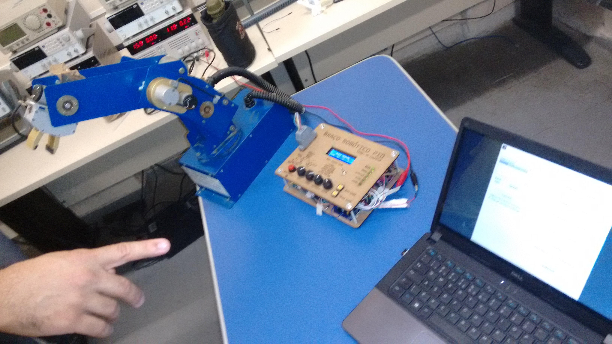
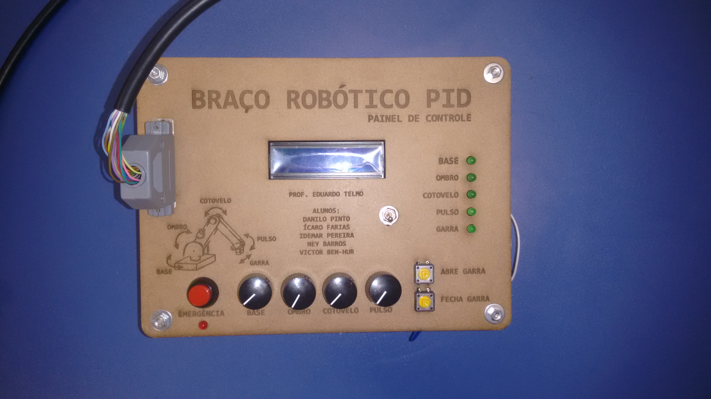

# Braço Robótico PID Arduino MATLAB
Desenvolvimento de um braço robótico PID controlado pelo Arduino via Matlab

Atividade desenvolvida na disciplina Microcontroladores do curso de Engenharia Elétrica do IFBA ministrada pelo Prof. Eduardo Santos Telmo. 

Link do vídeo https://www.youtube.com/watch?v=YRdU64J9sTQ

Membros:

Idemar dos Santos - [removido]

Danilo Pinto - [removido]

Ícaro Farias - [removido]

Victor Ben-Hur - [removido]

Ney Barros - [removido]

Os códigos do arduino e matlab encontram-se disponíveis neste repositório.
